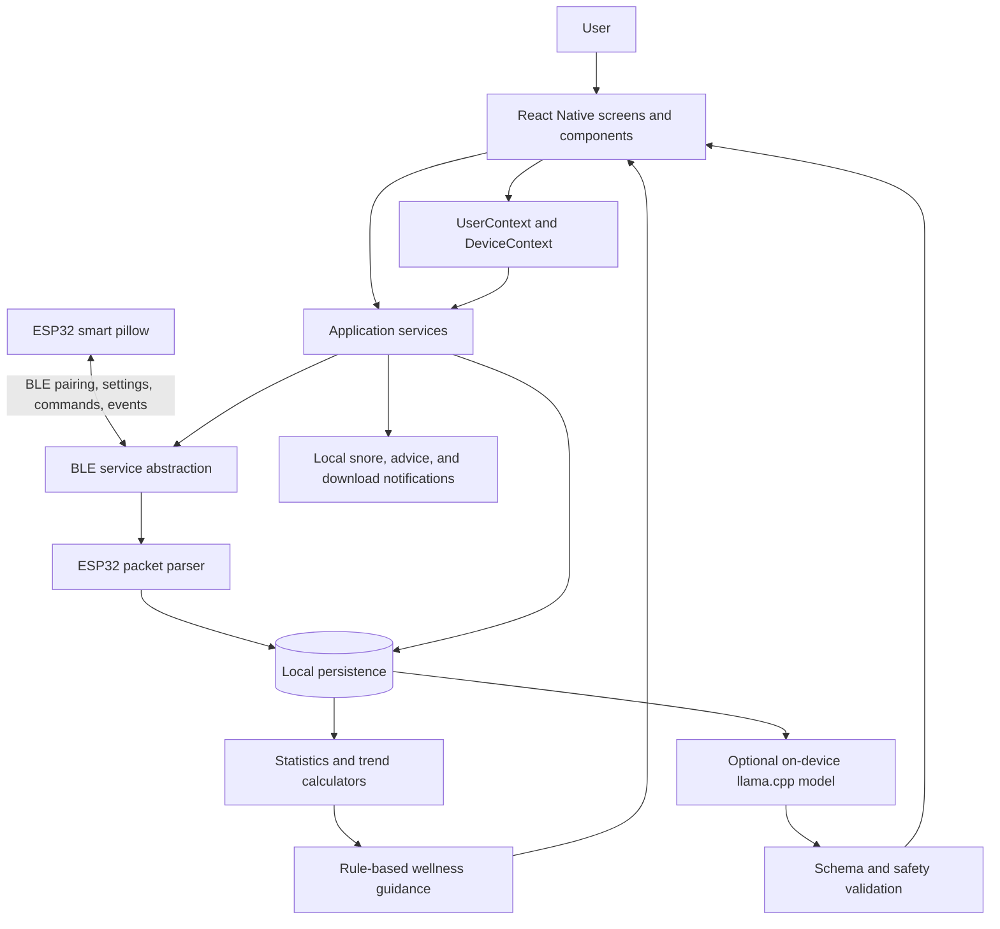
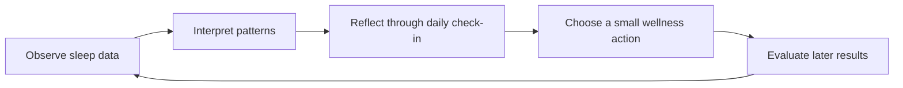

# HAGOKILLER Project Description

## 1. Project Overview

HAGOKILLER is a cross-platform companion application for an Internet of Things (IoT) smart pillow. The system monitors snoring activity, records pillow interventions, turns raw events into daily and monthly summaries, and presents understandable wellness guidance to the user.

The smart pillow uses an ESP32-based controller and microphone input to identify possible snoring. When the configured threshold is reached, the pillow can activate an air pump to gently adjust the user's head position. The mobile application connects to the pillow through Bluetooth Low Energy (BLE), stores received events locally, visualizes patterns, and provides safety-bounded recommendations.

HAGOKILLER is a wellness and monitoring tool. It is not a diagnostic system and does not replace assessment or treatment by a licensed healthcare professional.

## 2. Project Objectives

The project aims to:

- detect and record possible snoring events;
- support a configurable physical pillow intervention;
- help users recognize daily, nightly, and monthly sleep patterns;
- translate measurements into clear, actionable wellness information;
- preserve core functionality without continuous internet access;
- keep sensitive check-ins and sleep records on the user's device by default; and
- direct users toward professional evaluation when readings reach a critical level.

## 3. Intended Users and Scope

The primary users are adults who want to observe their snoring patterns and build better sleep-related habits. The application supports profile setup, pillow pairing, live event collection, historical review, daily check-ins, personalized wellness plans, and device configuration.

The current application targets Android and iOS through React Native and Expo. A web build is also supported for interface access and the download page, although native BLE, notifications, SQLite, and on-device AI behavior may differ or be unavailable on the web. Expo Go uses the mock BLE implementation because the real BLE and local AI modules require an installed native build.

## 4. Core Architecture

HAGOKILLER follows a layered, offline-first architecture. Screens and reusable components form the presentation layer. Context providers coordinate user and device state. Service modules isolate BLE communication, persistence, notifications, and AI execution. Pure utility modules calculate statistics, validate input, and generate deterministic recommendations.



### 4.1 Presentation and Navigation Layer

`App.tsx` initializes persistence, restores the user profile, installs the global providers, and defines the navigation structure. The main interface contains Dashboard, Logs, Night, Assessment, and Settings tabs, with additional Profile and Wellness Plan History screens.

The `src/screens` directory contains page-level behavior, while `src/components` contains reusable cards, charts, questionnaires, filters, dialogs, and navigation animation helpers. Shared colors and visual tokens are defined in `src/constants/theme.ts`.

### 4.2 State and Coordination Layer

- `UserContext` exposes the active user profile to the interface.
- `DeviceContext` coordinates pairing, connection state, pillow settings, commands, and device-related operations.
- Screen-local state handles transient concerns such as loading, refreshing, model download progress, and questionnaire input.

The contexts keep navigation screens from communicating directly with low-level hardware APIs.

### 4.3 Device Communication Layer

`bleService.ts` selects one of two interchangeable implementations:

- `RealBleService` uses `react-native-ble-plx` in an installed native application.
- `MockBLEService` supplies reproducible sample behavior when native BLE is unavailable, including Expo Go and development scenarios.

`esp32Protocol.ts` defines the BLE service and characteristic protocol. It parses binary ESP32 event packets into typed `SleepEvent` objects and encodes pillow settings and commands. Device settings include snore threshold, rolling detection window, pump duration, and microphone shift. Values are normalized and validated before use.

### 4.4 Persistence Layer

The native application uses Expo SQLite with write-ahead logging and indexed sleep-event timestamps. It stores:

- the user profile;
- the paired pillow and pairing state;
- pillow configuration;
- raw sleep and intervention events;
- notification preferences;
- daily activity check-ins;
- saved wellness plans; and
- feedback about suggested actions.

The database module also migrates older AsyncStorage values and older schema versions. The web-specific database adapter uses browser-compatible local storage behavior. `userStorage.ts` provides a stable storage facade so the rest of the app does not depend on a particular persistence implementation.

### 4.5 Analytics Layer

`statsCalculator.ts` converts stored events into:

- daily event counts, average duration, intervention count, peak hour, and severity;
- monthly summaries and improving, stable, or worsening trends;
- night-based summaries covering the evening-to-morning sleep window;
- hourly peak patterns; and
- an intervention-effectiveness estimate.

The analytics functions are deterministic and independently testable. Their results feed the dashboard, logs, night detail, assessment, notifications, and recommendations.

### 4.6 Wellness Guidance and AI Layer

The application always has a deterministic recommendation path in `recommendations.ts`. It combines measured severity, monthly trend, the user's daily check-in, and rotating wellness content to create explanations and low-risk actions.

For normal or elevated readings, an optional model can personalize the plan locally through `llama.rn` and llama.cpp. The model is downloaded once and stored in the application's private storage. Generated output is constrained to an expected structure, parsed, checked, and combined with the rule-based safety boundary. User feedback can influence a regenerated action.

Critical (`danger`) readings bypass generative AI. They retain deterministic, clinician-directed guidance so a model cannot weaken or replace the safety message.

The repository also contains an optional assessment API service and `server/assessment-advice.mjs`, which can connect to a local llama.cpp server or OpenAI through server-only credentials. Provider secrets must never be placed in an `EXPO_PUBLIC_*` variable.

### 4.7 Notification Layer

Notification services provide:

- snore/intervention alerts based on incoming events;
- a scheduled daily advice notification;
- completion or failure updates for the local AI model download; and
- a notification when a personalized plan is ready.

These services are platform-aware and degrade safely when notifications are unavailable.

## 5. End-to-End Data Flow

1. The application initializes local storage and restores the profile and paired-device state.
2. The user pairs with the pillow using the displayed seven-digit PIN.
3. The BLE layer authenticates the session and subscribes to event notifications.
4. The ESP32 monitors sound and applies its configured threshold and time window.
5. When an event occurs, the firmware can activate the pillow intervention and sends an event packet.
6. The application validates and converts the packet into a `SleepEvent`, then persists it locally.
7. Analytics functions aggregate events into daily, nightly, weekly, and monthly views.
8. The interface presents charts, event logs, severity labels, and intervention information.
9. The assessment combines measurements with the user's optional daily check-in.
10. Rule-based guidance is shown immediately; optional on-device AI may personalize low-risk actions for non-critical readings.
11. The user can review saved plans and mark actions as helpful, unhelpful, or not possible.

## 6. Core Pedagogical Module

HAGOKILLER is not a formal learning-management system, but it contains a pedagogical wellness module. Its purpose is to help users move from raw sensor readings to informed reflection and safer behavior. The learning design follows a short feedback cycle:



### 6.1 Learning Goals

The module helps the user:

- understand the meaning of event frequency, duration, intensity, and trends;
- connect daytime habits or conditions with observed sleep patterns;
- distinguish a low-risk wellness suggestion from medical advice;
- select small, practical actions instead of receiving an unexplained score; and
- recognize when persistent or critical patterns warrant professional evaluation.

### 6.2 Pedagogical Strategies

- **Data-to-meaning scaffolding:** Dashboard cards and severity labels progressively summarize detailed events.
- **Reflection:** The daily activity check-in encourages the user to consider contextual factors without claiming causation.
- **Actionable micro-learning:** Recommendations are expressed as a small set of practical actions with reasons.
- **Formative feedback:** Users rate suggested actions, allowing future plans to avoid unhelpful or impractical suggestions.
- **Progress reinforcement:** Improving measured trends can produce a supportive progress message without claiming that the user is cured.
- **Retrieval and continuity:** Logs, night details, and plan history let users revisit previous observations and compare them over time.
- **Safety literacy:** Critical results use consistent deterministic language that encourages clinical evaluation rather than self-diagnosis.

### 6.3 Pedagogical Inputs and Outputs

| Inputs | Processing | Outputs |
| --- | --- | --- |
| Snore count, duration, intensity, intervention data | Daily, nightly, and monthly aggregation | Charts, severity, peak periods, trend |
| Daily activities and optional note | Rule matching and optional local personalization | Context-aware wellness plan |
| Previous action feedback | Similarity filtering and plan regeneration | More practical future actions |
| Critical measured severity | Deterministic safety rules only | Conservative actions and referral guidance |

The module deliberately avoids presenting associations as proven causes. Sensor measurements and self-reported activities are used to support reflection, not diagnosis.

## 7. Other Functional Modules

| Module | Main responsibility | Representative files |
| --- | --- | --- |
| Onboarding and profile | Restore or create the local user profile | `App.tsx`, `NameInputScreen.tsx`, `ProfileScreen.tsx` |
| Dashboard | Summarize recent data and trends | `DashboardScreen.tsx`, `StatsCard.tsx`, `SnorePatternsChart.tsx` |
| Logs and night review | Browse events and inspect a sleep-night timeline | `LogsScreen.tsx`, `NightDetailScreen.tsx` |
| Assessment | Collect a check-in and present a wellness plan | `AssessmentScreen.tsx`, `AssessmentQuestionnaire.tsx`, `RecommendationCard.tsx` |
| Pillow management | Pair, reconnect, configure, and command the device | `DeviceContext.tsx`, `realBleService.ts`, `esp32Protocol.ts` |
| Local data | Store, migrate, retrieve, and clear user data | `database.ts`, `database.web.ts`, `userStorage.ts` |
| Analytics | Calculate summaries, trends, severity, and night detail | `statsCalculator.ts`, `wellnessAnalytics.ts` |
| Guidance | Produce deterministic and optional AI-personalized advice | `recommendations.ts`, `onDeviceAssessment.ts`, `aiAssessment.ts` |
| Notifications | Deliver snore, daily advice, model, and plan alerts | files ending in `Notifications.ts` under `src/services` |
| Download experience | Provide a responsive app-download page | `DownloadScreen.tsx` |

## 8. Technology Stack

- TypeScript, React 18, and React Native 0.76
- Expo SDK 52 and EAS Build
- React Navigation for stack and tab navigation
- `react-native-ble-plx` for native BLE communication
- Expo SQLite and AsyncStorage migration support
- `react-native-chart-kit` and `react-native-svg` for visualization
- Expo Notifications for local alerts
- `llama.rn` for optional on-device language-model inference
- Jest and React Test Renderer for automated tests

## 9. Privacy, Safety, and Reliability

- Sleep records, check-ins, plans, and action feedback are stored locally by default.
- On-device inference does not require check-in text to be uploaded.
- Public client environment variables contain endpoints only; provider credentials remain server-side.
- Critical guidance is deterministic and cannot be replaced by generated content.
- The application provides rule-based guidance when the local model is missing or fails.
- Packet parsing, input validation, schema migration, error boundaries, and test coverage reduce failure risk.
- Users can clear stored data through the application.

## 10. Configuration and Execution Notes

Copy `.env.example` to `.env` only when optional environment configuration is needed. The main commands are:

```bash
npm install
npm start
npm run web
npm run type-check
npm run lint
npm test
```

Real BLE and on-device AI require an installed native development or preview build rather than Expo Go. Android and iOS preview builds can be created with the provided `build:android` and `build:ios` scripts.

## 11. Summary

HAGOKILLER combines an ESP32 smart pillow, a local-first mobile application, deterministic analytics, and safety-bounded wellness guidance in a closed feedback loop. Its architecture separates hardware communication, persistence, analytics, guidance, and presentation so each concern can be tested and changed independently. Its pedagogical value comes from helping users observe their own data, reflect on context, take manageable actions, and recognize when professional help may be appropriate.
